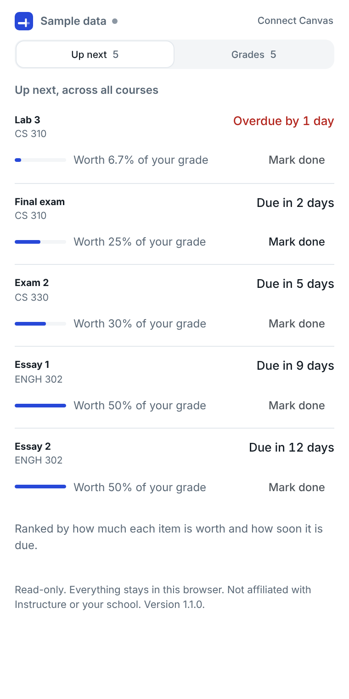
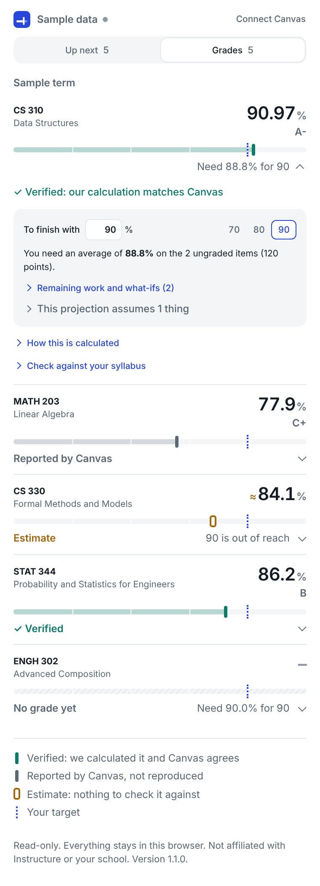
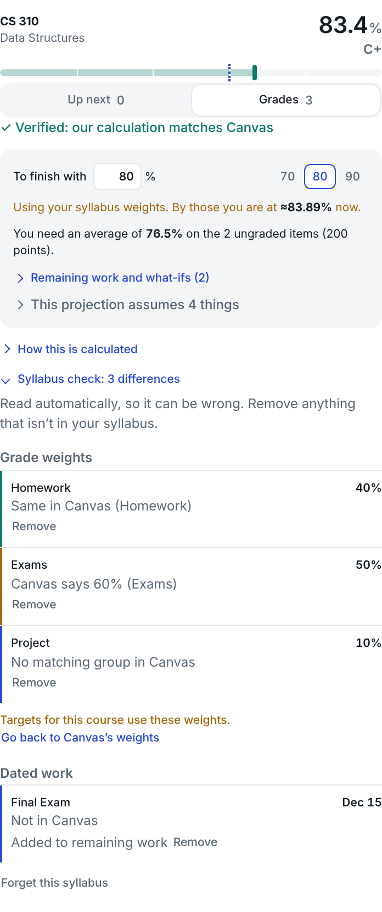

# Canvas Companion

A Chrome side panel for students on Canvas. It recalculates your grades and proves them against Canvas's own totals, ranks what to do next, tells you what you need on what is left, and shows where your syllabus and Canvas disagree.

Read-only. No server, no account, no access token. Nothing leaves your browser. See [PRIVACY.md](PRIVACY.md).

**Not on the Chrome Web Store.** Public distribution is on hold until the policy questions in [docs/POLICY.md](docs/POLICY.md) are answered. Load it unpacked for your own use.

| Up next | Grades | Syllabus check |
| --- | --- | --- |
|  |  |  |

## What it does

- **Verified grades.** The engine recalculates every course total (points-based, weighted, drop rules) and compares it with what Canvas reports. A number is shown as *verified* only when they agree. Otherwise it is labelled *reported by Canvas*, an *estimate* with its assumptions listed, or not shown at all.
- **Target solver.** Pick a target and it answers in one sentence: the average you need on what is left, that you are already safe, or that the target is out of reach and what the ceiling is. With one item left it answers in points on that item.
- **What-ifs and missing work.** Type a score for any ungraded item, or add work that is not in Canvas yet, such as an unposted final. Closed items you never submitted count as zero.
- **Up next.** One list across all courses, ranked by how much of your grade each item is worth and how soon it is due. Both numbers are on every row. Mark work done yourself when Canvas has no record of it, such as take-home or on-paper work.
- **What changed.** New grades, changed grades, moved due dates and new items since your last visit.
- **Syllabus check.** Upload a PDF or paste text. It reads grade weights and dated work, then shows what matches Canvas, what differs, and what Canvas does not have. If Canvas has no weights or the wrong ones, targets can use the syllabus weights instead.

## Run it

```
npm install
npm run build
```

1. Open `chrome://extensions`, turn on Developer mode, click **Load unpacked**, pick `.output/chrome-mv3`.
2. Sign in to Canvas in a tab.
3. Click the extension's toolbar icon, enter your Canvas address, click **Check access**.
4. Chrome asks to allow that one site. Allow it.

**Look around with sample data** works without Canvas. `npm run dev` rebuilds on save.

Disable the extension during proctored exams.

## How it is checked

| Command | What it proves |
| --- | --- |
| `npm test` | 190 unit tests: grade rules, drop rules checked against brute force, solver answers fed back through the engine, queue ranking, change detection, syllabus reading, Canvas client behaviour |
| `npm run typecheck` | Types |
| `npm run e2e` | Loads the built extension in Chrome against a stand-in Canvas that rejects tokens and answers only to a session cookie. Covers access, the queue and done marks, the solver, what-ifs, a new grade arriving, reading a real PDF syllabus, and noticing a newer build on disk. Also asserts that only GET requests to three endpoint kinds were sent. |

CI runs the type check, unit tests and build on every push.

Checked on a real Canvas (George Mason University) across several days: access works from extension code, every course with a reported total came out verified, and the queue's overdue, awaiting-grade and closed counts matched what Canvas showed.

## How it is put together

```
lib/core/            Pure functions. No Canvas, Chrome or React.
  engine.ts          Course totals, weights, drop rules, comparison with the reported total
  solver.ts          final(p) = base + slope * p, solved for the target
  scenario.ts        What-ifs and added work, applied to a copy of the gradebook
  queue.ts           Impact on the grade weighed against time left
  digest.ts          Snapshot and diff for "what changed"
  syllabus.ts        Rule-based syllabus reading and comparison with Canvas
lib/integration/     Where data comes from. The UI sees only CourseDataSource.
  canvas/            Two GET-only transports, a path allowlist, paging, mapping, the access check
  files/             PDF and text to plain text, in the browser
  ai/                Optional on-device model reader (experimental)
  mock/              Sample data covering every state
entrypoints/         Background worker and the side panel (React)
```

Design choices worth knowing:

- **The panel is meant to disappear into the browser.** One flat surface, hairlines instead of boxed cards, light and dark to match the system. Course rows are a glance when closed and a workspace when open.
- **The engine is separate from Canvas.** Integrations map their data into the domain model. To reach Canvas another way, add a `Transport` or a `CourseDataSource`; nothing else changes.
- **New features are data transformations.** What-ifs, added work and closed items produce a modified copy of the gradebook, and the same engine and solver run on it.
- **A wrong number is worse than no number.** Anything the engine cannot reproduce is labelled as such, and the solver refuses to project from it.
- **Syllabus reading is rules first.** Rules are free, repeatable and testable. An on-device model can add to them but never overrides them, and everything read is shown for review with its source.

## Limits

- It can only see what Canvas lists. Work graded elsewhere, or not posted yet, has to be added by hand.
- Grading periods and late-penalty deductions are untested. If a course uses them, its total shows as *reported*, not as a wrong number.
- The syllabus reader handles common layouts (dotted tables, bullets, "Name: date" lines). Scanned PDFs and unusual tables will be missed.
- The on-device model path has no automated tests.
- Chrome and Edge only. Extensions do not run in mobile browsers.

## License

MIT. See [LICENSE](LICENSE).
